## {#title-id data-menu-title="Git and GitHub" }

:::{.centerh style="margin-top: 5em;"}
[Git and GitHub]{.hlb style="font-size: 200%;"}
:::

:::{.centerh style="margin-top: 1em;"}
_What they are, what the words mean, and why people use them_
:::

:::{.title-logos}
{.logo-git fig-alt="git logo"}
{.logo-github fig-alt="GitHub logo"}
:::

## Ever done this?

- `report.doc`, `report_v2.doc`, `report_final.doc`, `report_final_REALLY.doc`
- "Which version did I send to Brian?"
- "It worked last Tuesday. What did I change?"
- Two people editing the same file and one losing their work

::: notes
Open with a shared pain everyone recognises, coders or not. Ask for a show of
hands: who has done the "final_v2" thing? This is the problem git solves:
never lose work, see exactly what changed and why, experiment safely, and
collaborate without emailing files around.
Aim to be done with this slide by minute 2.
:::

## What is git?

- A **version control system**: it records the history of a folder of files
- Free, runs on *your own* computer, works offline
- Written by Linus Torvalds in 2005 to manage the Linux kernel
- **Distributed**: every copy has the full history
- Successor to tools some of you may know: SCCS, RCS, CVS, Subversion

::: notes
Key message: git is a program, like a word processor is a program. It lives on
your machine. No internet or account needed.
Expect a question about "distributed" vs the older central-server systems
(CVS/Subversion). Short answer: no single master server you depend on; every
copy is a complete backup. Mention that "git" is British slang, and Torvalds
joked he names projects after himself.
Lead straight into the next slide: "So if git is on your machine, what's GitHub?"
:::

## Git vs GitHub

:::: {.columns}
::: {.column width="50%"}
[git]{.subhead}

- A program
- Runs on your computer
- Free, open source
- Works with no internet
:::
::: {.column width="50%"}
[GitHub]{.subhead}

- A website (owned by Microsoft)
- Stores copies of git repos online
- Adds sharing, discussion and automation
- Rivals: GitLab, Codeberg, ...
:::
::::

**GitHub is like Dropbox for git projects, plus a noticeboard.**

::: notes
This is the slide the audience most needs. Say it twice: you can use git
without GitHub, but GitHub is built around git. GitHub hosts the repository
and adds a website on top. Another way to put it: git is to GitHub as email
is to Gmail. Pause for questions; this usually triggers several.
Automation example: GitHub Actions. When someone pushes a change to our club
website, GitHub automatically publishes it to our web host. Nobody has to
upload files by hand. That's a GitHub feature, not part of git. Keep it to
that; no need to go into how it works.
:::

## The core vocabulary

| Term | Plain English |
|------|---------------|
| **Repository** ("repo") | A project folder whose history git is tracking |
| **Commit** | A saved snapshot of the files, with a note saying what changed and who did it |
| **History / log** | The list of all commits, oldest to newest |
| **Diff** | The differences between two versions |

::: notes
A commit is like a photo of the whole project at a moment in time, with a
caption. You choose when to take it. Each commit gets a long ID (a hash),
which is why you see strings like a1b2c3d on GitHub. You can always go back to
any commit.
If asked how you make a commit: edit files, "stage" the changes you want
(git add), then commit (git commit). Don't go into more detail than that.
:::

## Branches and merging

```{mermaid}
%%| fig-width: 11
%%{init: {"gitGraph": {"rotateCommitLabel": false}, "themeVariables": {"commitLabelBackground": "#1f3a5f", "commitLabelColor": "#ffffff", "git0": "#f05033", "git1": "#6e40c9", "gitBranchLabel0": "#ffffff", "gitBranchLabel1": "#ffffff"}}}%%
gitGraph
  commit id: "Start"
  commit id: "Add menu"
  branch new-feature
  checkout new-feature
  commit id: "Try idea"
  commit id: "Fix idea"
  checkout main
  commit id: "Fix typo"
  merge new-feature
  commit id: "Release"
```

- **Branch**: a parallel line of work, so you can experiment safely
- **Merge**: bring the changes from one branch back into another
- **main** (formerly "master"): the usual name for the primary branch

::: notes
Analogy: photocopy the document, scribble on the copy, and if you like the
result fold the changes back in. If not, throw the copy away and nothing is
harmed. Possible question on "conflicts": when two branches change the same
lines, git asks a human to decide. Keep it brief.
If the master/main renaming comes up, keep it short: GitHub changed the
default in 2020.
:::

## Working with others

| Term | Plain English | |
|------|---------------|:-:|
| **Remote** | A copy of the repo elsewhere, often GitHub | [git]{.tag-git} |
| **Clone** | Download a full copy, history and all | [git]{.tag-git} |
| **Push / Pull** | Send your commits up / fetch others' down | [git]{.tag-git} |
| **Fork** | Your own copy of someone else's repo | [GitHub]{.tag-github} |
| **Pull request** | "Please pull my changes into your project" | [GitHub]{.tag-github} |
| **Issue** | A bug report or feature request | [GitHub]{.tag-github} |

::: notes
Clone, push and pull are git words. Fork, pull request and issue are GitHub
words (other sites have equivalents; GitLab says "merge request").
That distinction reinforces the git vs GitHub slide.
:::

## What you've seen on GitHub

- **README**: the project's front page, shown below the file list
- **Code ▸ Download ZIP**: just the files, *without* the history
- **Releases**: packaged, ready-to-use versions
- **Commits** count and dates: is the project alive?
- **Stars**: a rough measure of popularity
- **Issues**: known problems, and where to report new ones

[Example projects on GitHub: [Pi-hole](https://github.com/pi-hole/pi-hole) | [Audacity](https://github.com/audacity/audacity) | [This presentation](https://github.com/paulstallard/presentation_git_github_tinkers)]{.demo-links}

::: notes
Connect to what members have already done: downloaded a project or a
Raspberry Pi tool from GitHub. Good practical tip: check the date of the last
commit and the open issues before trusting a project.

LIVE DEMO (about 3 minutes). Links open in a new tab; close it to come back.
Open one project and walk around it from its main page. Pi-hole is the main
one; Audacity and this presentation are there as alternatives or extras.
Ask first: "Who runs Pi-hole at home?" Expect a few hands.

Pi-hole: "If you run Pi-hole, this is where it's made."
- Top: owner/name (pi-hole/pi-hole). Point at the star count (60,000+).
- The file list is the repository. Scroll down: the README is the front
  page, and it has the one-line install command people may have used.
- The green Code button: Download ZIP gives just the files; clone gives the
  full history (that's git).
- "N commits" link (above the file list): the history from the vocabulary
  slide. Click a commit to show the diff (red = removed, green = added).
- Branch dropdown / "N branches": the branches slide for real. The main
  branch is still called "master"; day-to-day work goes into "development";
  fixes get their own branches (fix/...), and are merged when ready.
- Issues tab: bug reports from users. Open one with discussion and show it's
  just people talking about a problem.
- Pull requests tab: "Please pull my changes in." Open a merged one: the
  description, discussion, and the "Files changed" tab (the diff again).
  PRs here target "development", not "master".
  Point at the green tick (or red cross) on a PR or commit: that's GitHub
  Actions running automatic checks on every change, just as Actions
  publishes our club website. No need to open the Actions tab.
- Releases (right-hand sidebar): version numbers and release notes. This is
  how you'd know what changed when Pi-hole says an update is available.
- Click the "pi-hole" owner name: Pi-hole is several repositories (FTL, web
  and others) under one owner.

Audacity: a program everyone knows. Its Releases page has ready-made
downloads for Windows, Mac and Linux.

This presentation: git isn't just for code. Small and personal: show the
commit history of the slides you're looking at.

Before the talk: pick one good issue and one merged PR, and note them here so
you don't have to hunt live. Take screenshots in case the wifi fails.

If asked "does everything use GitHub?": github.com/torvalds/linux is only a
read-only copy. Linux changes still arrive as emailed patches.
:::

## Questions?


::: {style="margin-top: 3em;"}
- Getting started: <https://git-scm.com>
- Free book: *Pro Git* at <https://git-scm.com/book>
- GitHub's own guides: <https://docs.github.com/get-started>
:::

::: notes
Git isn't just for code: notes, websites, config files, even this talk (these
slides are written in Quarto and kept in git).
The organiser will handle any follow-up meeting and see who's interested, so
no need to mention it here.
:::
